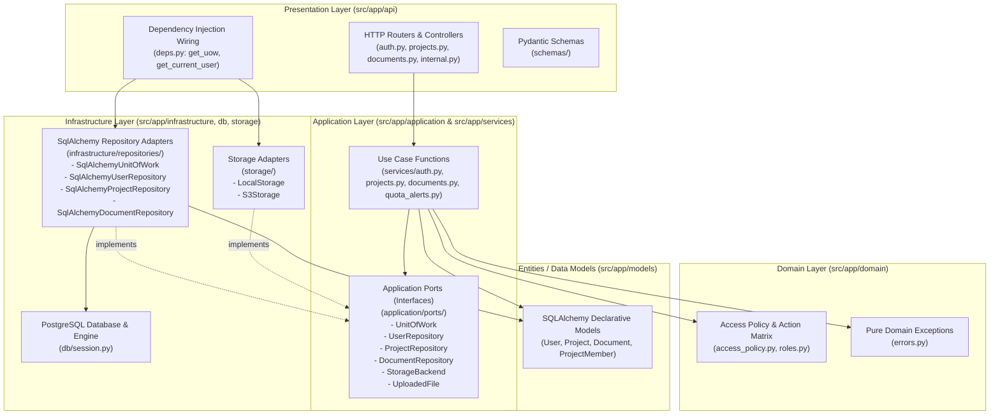

# Architectural Decisions and Compromises

## 1. Clean Architecture & Layer Decoupling

The project implements Clean Architecture principles with strict boundary enforcement validated via automated AST tests (`tests/unit/test_architecture.py`):

### Layer Responsibilities

- **Presentation Layer (`src/app/api/`)**:
  HTTP routing, request deserialization/validation via Pydantic schemas, HTTP status codes, and exception translation. Controllers **never** import `sqlalchemy` or infrastructure adapters (restricted to `deps.py`).
- **Application Layer (`src/app/application/`, `src/app/services/`)**:
  Orchestrates business use cases as pure functions. Owns the transaction boundary via `UnitOfWork`. Interacts exclusively with ports (`application/ports/`). Completely decoupled from `fastapi`, `starlette`, `boto3`, and direct database sessions.
- **Domain Layer (`src/app/domain/`)**:
  Contains business rules, role definitions (`ProjectRole`), pure access policy matrices (`can_perform`, `Action`), and framework-agnostic error categories (`DomainError`, `NotFoundError`, `PermissionDeniedError`). Zero external dependencies.
- **Infrastructure Layer (`src/app/infrastructure/`, `src/app/db/`, `src/app/storage/`)**:
  Implements application ports using concrete technologies: SQLAlchemy 2.0 ORM & PostgreSQL raw queries (`infrastructure/repositories/`), local disk storage (`storage/local.py`), and AWS S3 (`storage/s3.py`).

---

## 2. Ports and Adapters Mapping

| Port (Interface / Protocol) | Location | Adapter (Implementation) | Location | Description |
|---|---|---|---|---|
| `UnitOfWork` | `src/app/application/ports/unit_of_work.py` | `SqlAlchemyUnitOfWork` | `src/app/infrastructure/repositories/unit_of_work.py` | Transaction boundary manager (`commit`, `rollback`, context manager). |
| `UserRepository` | `src/app/application/ports/user_repository.py` | `SqlAlchemyUserRepository` | `src/app/infrastructure/repositories/user_repository.py` | User lookup by ID / login, persistence with `23505` uniqueness check. |
| `ProjectRepository` | `src/app/application/ports/project_repository.py` | `SqlAlchemyProjectRepository` | `src/app/infrastructure/repositories/project_repository.py` | Project CRUD, membership checks, and raw SQL aggregate queries. |
| `DocumentRepository` | `src/app/application/ports/document_repository.py` | `SqlAlchemyDocumentRepository` | `src/app/infrastructure/repositories/document_repository.py` | Document queries, persistence, and storage key listing. |
| `StorageBackend` | `src/app/application/ports/storage.py` | `LocalStorage` `S3Storage` | `src/app/storage/local.py` `src/app/storage/s3.py` | Physical binary file persistence (Local disk / AWS S3). |
| `UploadedFile` | `src/app/application/ports/uploaded_file.py` | `FastApiUploadedFile` | `src/app/api/documents.py` | Framework-agnostic synchronous streaming upload port. |

---

## 3. End-to-End Request Lifecycle

### Example: Uploading Documents (`POST /project/{project_id}/documents`)

1. **HTTP Ingestion**:
   Client sends `multipart/form-data` with JWT Bearer header to `POST /project/{project_id}/documents`.
2. **Presentation Layer & Authentication**:
   - `deps.py:get_current_user` extracts and verifies the JWT token.
   - `deps.py:get_uow` creates a `SqlAlchemyUnitOfWork` instance bound to the request database session. FastAPI caches this dependency per request (`use_cache=True`), ensuring the route handler and authentication share the exact same transaction context.
   - `api/documents.py:upload_files` adapts each `fastapi.UploadFile` into a `FastApiUploadedFile` implementing the `UploadedFile` port.
3. **Application Layer (Use Case)**:
   - `services/documents.py:upload_documents` coordinates the operation.
   - Evaluates domain permissions via `access.py:require_project_access(..., action=Action.UPLOAD_DOCUMENT)`.
   - Reads incoming data in 64 KB chunks via `read_upload_file_limited`, validating MIME types and magic bytes.
   - Locks the project row (`uow.projects.get_by_id_for_update`) to prevent quota bypass from concurrent uploads.
4. **Infrastructure Layer**:
   - Saves binary content to `StorageBackend` under a canonical key format `projects/<pid>/<did>/<stored_name>`.
   - Records metadata rows via `uow.documents.add(doc)`.
   - Commits the transaction atomically via `uow.commit()`.
5. **Presentation Response**:
   - The route handler validates the created documents against `DocumentResponse` Pydantic schemas and returns `HTTP 201 Created`.

---

## 4. Architectural Trade-offs and Deliberate Compromises

### 1. Entities vs. Shared Declarative Models
- **Context**: In strict Domain-Driven Design, the domain layer defines pure dataclass entities with zero infrastructure awareness, requiring dedicated mappers to convert between domain entities and ORM models.
- **Design Decision**:
  - `src/app/domain/` contains pure rules, policy matrices, roles, and exception hierarchies (`access_policy.py`, `roles.py`, `errors.py`).
  - Data entities are declarative SQLAlchemy models located in `src/app/models/` (`User`, `Project`, `Document`, `ProjectMember`).
- **Rationale**: For the scope and size of this service, creating a secondary mirrored set of pure dataclasses and maintaining bidirectional mapping layers would result in significant boilerplate, duplication, and potential object synchronization bugs without proportional architectural benefit. Declarative models act as shared persistence models, while domain access policy functions protect business invariants.

### 2. Dual-Write Failure Mode in Project Deletion
- **Location**: `src/app/services/projects.py:delete_project`
- **Context**: Deleting a project requires deleting both its database records (projects, project_members, documents via cascades) and physical files in object storage (S3 / LocalStorage).
- **Execution Order**:
  1. Project document storage keys (`stored_filename`) are retrieved via `uow.documents.list_stored_filenames(project_id)`.
  2. Database deletion is committed atomically via `uow.projects.delete(project)` and `uow.commit()`.
  3. Physical files are deleted sequentially from the storage backend.
- **Known Compromise**:
  If physical file deletion fails (e.g. S3 transient network failure, timeout) after the DB transaction has already committed, the error is logged at `WARNING` level and the operation returns `204 No Content` rather than raising a `500 Internal Server Error`.
- **Rationale**:
  The database transaction cannot be rolled back after commit. Raising a 500 would deceive the client into thinking the project still exists, while its database records have already been permanently purged. If physical file deletion fails, the files remain in the storage backend as orphaned files, the error is logged as a warning, and cleanup must be performed manually or via a future orphan-scan maintenance script. This is a known architectural compromise.
